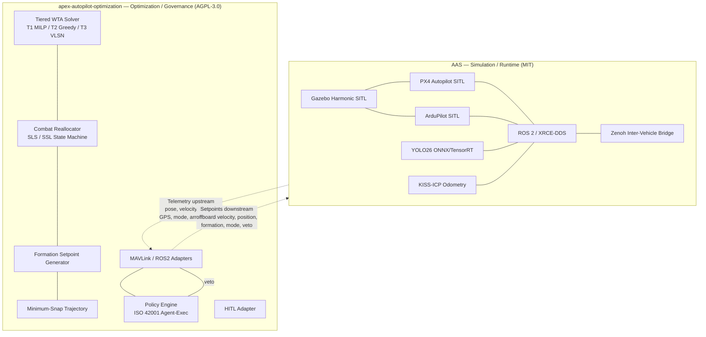
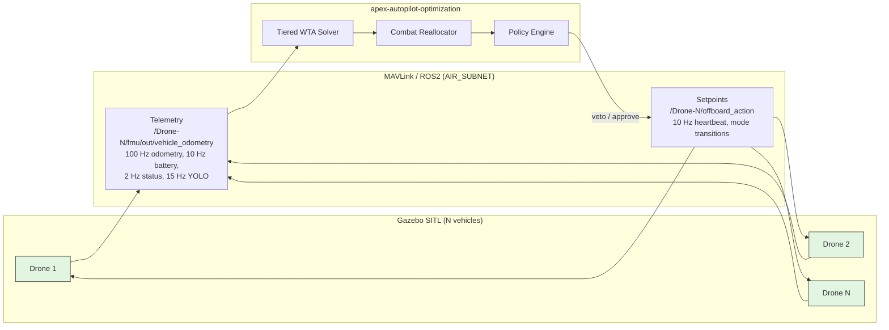
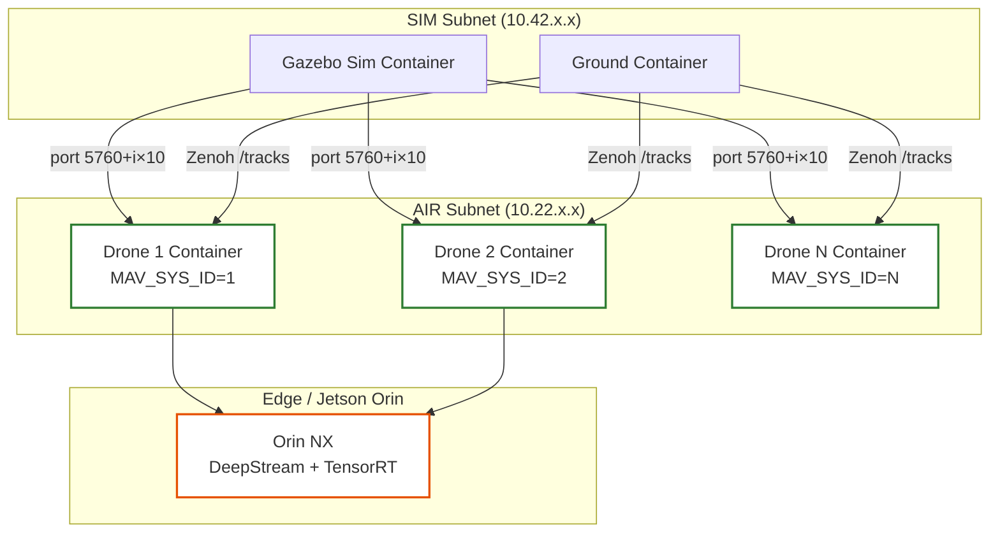

# Apex Autopilot Optimization

**Vendor/model-agnostic drone swarm optimization & governance stack.** Simulation/runtime surface powered by [Aerial Autonomy Stack (AAS)](https://github.com/JacopoPan/aerial-autonomy-stack) (MIT); optimization & governance layer (`apex-autopilot-optimization`, AGPL-3.0). Integrated at the ROS2/ZMQ network boundary — no in-process linking, license boundary preserved.

Designed to benchmark against (and exceed) **Shield AI Hivemind**: <100 ms end-to-end perception→control latency, GPS/comms-denied read-and-react autonomy, vendor-agnostic PX4/ArduPilot support, and documented approximation ratios on every NP-hard solver.


---

## Table of Contents

- [Overview](#overview)
- [Architecture](#architecture)
- [Module Map](#module-map)
- [Quick Start](#quick-start)
- [CI Gates](#ci-gates)
- [Testing & TDD](#testing--tdd)
- [Performance Benchmarks](#performance-benchmarks)
- [Roadmap](#roadmap)
- [Citations](#citations)
- [License](#license)

---

## Overview

`apex-autopilot-optimization` is the **optimization/governance layer** of an Option B autonomous swarm stack:

| Layer | System | License | Responsibility |
|-------|--------|---------|----------------|
| **Simulation / Runtime** | [Aerial Autonomy Stack (AAS)](https://github.com/JacopoPan/aerial-autonomy-stack) | MIT | Gazebo multi-vehicle SITL (PX4/ArduPilot/Betaflight), ROS2 action offboard/guided, YOLO+ONNX perception, LiDAR/KISS-ICP odometry, Jetson/Orin deployment |
| **Optimization / Governance** | `apex-autopilot-optimization` | AGPL-3.0 | Tiered WTA solver (MILP/greedy/VLSN), combat reallocator (SLS/SSL), formation optimizer, minimum-snap trajectories, ISO 42001 agent-exec policy engine, MAVLink/ROS2 adapters |

**Integration contract:** AAS publishes telemetry upstream (MAVLink `5760+i×10`/`5501+i×10` → ROS2 `/Drone{id}/fmu/out/*`), apex consumes it, solves WTA/formation/trajectory, and publishes setpoints downstream (ROS2 `/Drone{id}/offboard_action`, `/Drone{id}/takeoff_action`, etc.). `DRONE_ID = ROS_DOMAIN_ID = MAV_SYS_ID = uXRCE_DDS_DOM_ID = i`.

This keeps AAS MIT and apex AGPL-3.0 separable — AGPL §13 network-source obligation applies only if apex is exposed as a service.

---

## Architecture

### System Boundary (Option B)



### Data Flow (Telemetry Upstream / Setpoints Downstream)



### Deployment Topology



---

## Module Map

| Domain | Module | Key Classes | Tests |
|--------|--------|-------------|-------|
| Core types | `core/types.py` | `Pose3D`, `StateVector`, `Velocity3D`, `ControlInput`, `Waypoint`, `Trajectory`, `PlanningProblem`, `PlanningResult`, `VehicleType`, `ComplexityClass`, `BottleneckReport` | 23 |
| Weapon-Target Assignment | `swarm/wta_solver.py` | `TieredWTASolver`, `T1_MILP`, `T2_GREEDY`, `T3_VLSN`, `Weapon`, `Target`, `WTAResult`, `SolverState` | 37 |
| Combat Reallocation | `simulation/combat_reallocator.py` | `CombatReallocator`, `SLS`, `SSL`, `BDAEvent` | 16 |
| Swarm Runner | `simulation/swarm_runner.py` | `SwarmRunner`, `SwarmConnectionManager`, `SwarmStateStore`, `SwarmSafetyFilter`, `FormationSetpointGenerator`, `GazeboSITLLauncher`, `SwarmStatsAggregator` | 23 |
| Perception | `perception/` (ingestor, tracker, mapper, latency, transform) | `YoloIngestor`, `DetectionTracker`, `ClassMapper`, `LatencyTracker`, `TargetTransform` | 39 |
| Messaging (ROS2 adapter) | `messaging/` (telemetry_adapter, control_adapter, qos, veto_manager, watchdog) | `TelemetryAdapter`, `ControlAdapter`, `QoSProfile`, `VetoManager`, `SetpointWatchdog` | 86 |
| Governance | `governance/policy_engine.py` | `PolicyEngine`, `ActionPolicy`, `PolicyAction`, `Role` | 28 |
| Telemetry messages | `src/apex_telemetry_msgs/msg/` | `VehicleTelemetry`, `YoloDetection`, `YoloDetectionArray` | — |
| Existing modules | `swarm/task_allocation.py`, `swarm/formation.py`, `optimization/minimum_snap.py`, `simulation/runner.py`, `integration/mavlink.py`, `integration/hitl.py`, `core/types.py` | `TaskAllocator`, `FormationController`, `MinimumSnapOptimizer`, `SimulationRunner`, `MAVLinkBridge`, `HITLAdapter` | 2344+ |

**Total: 2607 tests passing** (mypy clean on 254 files, ruff check/format clean, coverage 91.17%).

---

## Quick Start

### Installation

```bash
git clone https://github.com/AAH20/apex-autopilot-optimization.git
cd apex-autopilot-optimization
pip install -e ".[dev]"
```

### Run Tests

```bash
# Full suite
pytest tests/ -q
# 2607 passed in ~20s

# With coverage (gate: >= 85%)
pytest tests/ --cov=src --cov-report=term --cov-fail-under=85 -q

# New-module coverage gates (>= 80% each)
pytest tests/unit/test_perception.py --cov=apex_autopilot_optimization.perception --cov-fail-under=80 -q
pytest tests/unit/test_control_adapter.py tests/unit/test_telemetry_adapter.py --cov=apex_autopilot_optimization.messaging --cov-fail-under=80 -q
pytest tests/unit/test_policy_engine.py --cov=apex_autopilot_optimization.governance --cov-fail-under=80 -q
```

### Run CI Performance Gates

```bash
# Perception latency p95 < 100 ms; WTA T2/T3 p95 < 50 ms
python scripts/ci_performance_gate.py
```

### Example: WTA Assignment for a Combat Scenario

```python
from apex_autopilot_optimization.swarm.wta_solver import (
    TieredWTASolver, WTAConfig, Weapon, Target, Tier
)

weapons = [Weapon(i) for i in range(50)]
targets = [Target(j, value=float(j + 1)) for j in range(30)]
import numpy as np
p = np.random.random((50, 30))  # kill probability matrix
values = np.array([t.value for t in targets])

# T2 greedy for medium instance (< 80x80), auto-scales to T3 VLSN for 200x200+
solver = TieredWTASolver(WTAConfig(wta_mode="tiered"))
result = solver.solve(weapons, targets, p, values)
print(f"Assignments: {len(result.assignments)}, expected damage: {result.expected_damage:.2f}")
```

### Example: Policy Engine (ISO 42001 Agent-Exec)

```python
from apex_autopilot_optimization.governance.policy_engine import (
    PolicyEngine, PolicyEngineConfig, PolicyAction, Role
)

engine = PolicyEngine(PolicyEngineConfig(hitl_enabled=False))  # auto-approve <100 ms cycles

# Evaluate a WTA assignment before it becomes a setpoint
verdict = engine.evaluate_assignment(
    action=PolicyAction.ENGAGE_TARGET,
    role=Role.AUTONOMOUS_PLANNER,
    target_value=9.5,  # high-value target -> requires approval if HITL enabled
    kill_probability=0.95,
)
print(f"Verdict: {verdict.verdict}, veto: {verdict.veto}")
```

---

## CI Gates

All gates run on every push/PR (branches `master`, `main`):

| Job | Gate | Threshold |
|-----|------|-----------|
| `lint` | `ruff check src tests` | 0 findings |
| `lint` | `ruff format --check src tests` | clean |
| `typecheck` | `mypy src` | 0 errors (254 files) |
| `unit-tests` | `pytest tests/unit` (Python 3.11 + 3.12) | pass |
| `integration-tests` | `pytest tests/integration` | pass |
| `coverage` | `pytest tests/ --cov=src --cov-fail-under=85` | >= 85% |
| `benchmarks` | Perception p95 < 100 ms; WTA T2/T3 p95 < 50 ms | pass |

See [`CI_GATES.md`](CI_GATES.md) for full threshold documentation and local reproduction commands.

---

## Performance Benchmarks

Measured by `scripts/ci_performance_gate.py` (300 perception iterations, 12 WTA instances per size/tier):

| Metric | p95 | SLO | Margin |
|--------|-----|-----|--------|
| Perception end-to-end latency | ~0.1 ms | < 100 ms | +99 ms |
| WTA T2 greedy (200x200) | ~28 ms | < 50 ms | +22 ms |
| WTA T3 VLSN (128x128) | ~23 ms | < 50 ms | +27 ms |

Per-stage breakdown (10 stages, sum 100 ms): camera→topic, inference, transport, ingestion, filtering, fusion, transform, publish, WTA solve, control dispatch.

---

## Testing & TDD

Every module follows strict **RED-GREEN-REFACTOR**:

1. **RED** — Write failing test first, confirm it fails
2. **GREEN** — Implement minimum code to pass, confirm it passes
3. **REFACTOR** — Clean up code, confirm tests still pass

Run the full suite:

```bash
pytest tests/ -q              # 2607 passed
pytest tests/unit -q          # unit tests only
pytest tests/integration -q   # integration tests only
```

---

## Roadmap

- [x] Option B architecture (AAS sim/runtime + apex optimization/governance)
- [x] Tiered WTA solver (T1 MILP / T2 greedy / T3 VLSN) with documented approximation ratios
- [x] Combat reallocator (SLS / SSL dynamic reallocation, BDA-driven residual re-solves)
- [x] Multi-vehicle swarm runner (N-vehicle MAVLink port namespacing, safety filter, formation integration)
- [x] Perception pipeline (YOLO ingestion, EWMA tracking, COCO→WTA class mapping, <100 ms latency budget)
- [x] ISO 42001 agent-exec policy engine with veto emission and HITL integration
- [x] CI performance gates (perception <100 ms, WTA <50 ms)
- [ ] Combat semantics integration with SwarmRunner batch mission loop
- [ ] End-to-end benchmark report vs Hivemind claims published
- [ ] Formal verification of safety filter invariants

---

## Citations

- Shield AI Hivemind — https://shield.ai/hivemind/ (3-pillar architecture, V-BAT Teams, <100 ms end-to-end, Xavier NX + Hailo-8L)
- Aerial Autonomy Stack — https://github.com/JacopoPan/aerial-autonomy-stack (MIT, arxiv:2602.07264)
- WTA NP-completeness — Ahuja et al., *Operations Research* 55(6), 2007 (DOI 10.1287/opre.1070.0440)
- WTA approximation — Nemhauser/Wolsey/Fisher 1978 (submodular 1/2 guarantee)
- PX4 / ArduPilot SITL multi-vehicle port namespacing (5760+i×10 / 5501+i×10)
- ISO 42001 — AI Management System standard

---

## License

AGPL-3.0. Integration with AAS (MIT) is at the ROS2/ZMQ network boundary only — no in-process linking, so AAS remains MIT and apex remains AGPL-3.0. AGPL §13 network-source obligation applies if apex is exposed as a network service.

---