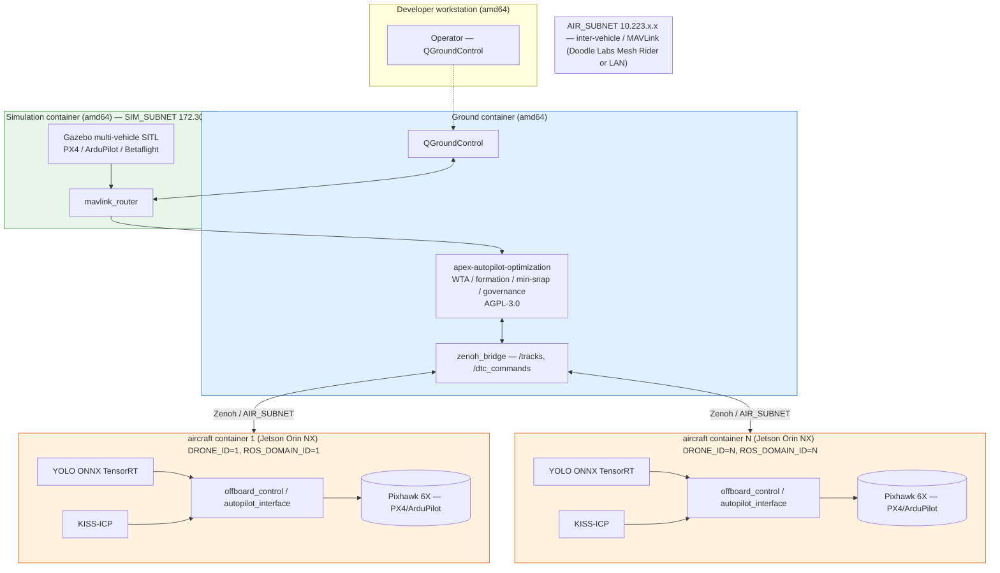

# ADR-0001: Option B Integration — AAS ↔ apex-autopilot-optimization

**Status:** Proposed
**Deciders:** Architecture review
**Date:** 2026-10-19
**Kanban card:** `t_d4c5bfcb` (tracks Option B integration delivery)
**Repositories:**
- AAS (sim/runtime surface): `github.com/JacopoPan/aerial-autonomy-stack` — MIT
- apex-autopilot-optimization (governance/optimization layer): `github.com/AAH20/apex-autopilot-optimization` — AGPL-3.0 (local: `~/Downloads/2000 workflows/projects/apex-autopilot-optimization/`)

---

## 1. Problem statement

The program needs a vendor-agnostic multi-drone simulation stack that can benchmark against (and exceed) Shield AI Hivemind, using Aerial Autonomy Stack (AAS) as the simulation/runtime surface and apex-autopilot-optimization as the optimization/governance layer. The two codebases live under incompatible licenses (MIT vs AGPL-3.0), are developed in separate repositories, and must be integrated without creating license contamination or a single points of coupling.

Today the boundary is undefined:
- It is unclear which capabilities run in AAS (Gazebo multi-vehicle SITL, PX4/ArduPilot offboard control, YOLO perception, LiDAR/KISS-ICP, Jetson/Orin deployment) versus apex-autopilot-optimization (WTA solver, formation optimizer, minimum-snap trajectories, safety/governance chassis, ISO 42001 agent-execution policy).
- No interface contract exists for telemetry flowing into apex or setpoints flowing out to vehicles.
- No deployment topology maps simulation container, ground container, and Jetson/Orin aircraft containers to subsystems.

Known constraints from context:
- PX4 Gazebo SITL is limited to under 10 vehicles; exact WTA is NP-complete and intractable beyond 20×20, so a greedy approximation is used.
- ~4 GB RAM per Gazebo instance; end-to-end latency budget is under 100 ms (Hivemind benchmark).
- Per-vehicle identity: `DRONE_ID = ROS_DOMAIN_ID = MAV_SYS_ID (= uXRCE_DDS_DOM_ID)`; port namespacing `5760 + i×10` (master) and `5501 + i×10` (SITL).
- Dual network: `SIM_SUBNET` (simulated sensors) and `AIR_SUBNET` (inter-vehicle / MAVLink).
- License boundary: AGPL-3.0 apex plus MIT AAS must remain separable.

## 2. Options considered

| Option | Description |
|--------|-------------|
| **A — All-in-apex** | Port Gazebo SITL, YOLO, KISS-ICP, offboard control, and Jetson deployment into apex-autopilot-optimization; AAS unused except as a reference. |
| **B — Split boundary (chosen)** | AAS owns sim/runtime/perception/deployment; apex owns swarm optimization + safety/governance. Couple only via MAVLink telemetry (upstream) and ROS2 setpoints (downstream) across a thin adapter layer. |
| **C — All-in-AAS** | Implement WTA, formation, minimum-snap, governance, and ISO 42001 policy inside AAS; apex-autopilot-optimization unused. |

**Option A rejected:** AAS is purpose-built for multi-vehicle Gazebo SITL, ROS2 offboard/guided, YOLO+ONNX, LiDAR/KISS-ICP, and Jetson/Orin Docker deployment; re-implementing that in apex duplicates an existing MIT-licensed flight-proven stack and moves runtime concerns into an AGPL-3.0 governance repo where they do not belong.

**Option C rejected:** AAS (MIT) has no swarm task allocator, formation optimizer, minimum-snap trajectory generator, safety/governance chassis, or ISO 42001 agent-execution policy; apex-autopilot-optimization (AGPL-3.0) already implements these with 560 green tests. Moving them into AAS would either force AAS under AGPL-3.0 derivative terms or create a fork that diverges from the maintained optimization layer.

**Option B selected:** Keeps each repo in its domain, preserves both licenses, and couples them only through a well-defined, protocol-level interface that neither side implements in the other's code.

## 3. Decision

**Adopt Option B.** Integrate AAS and apex-autopilot-optimization as separate, independently deployable works connected by a stable interface contract:

- **Upstream (vehicle → apex):** MAVLink telemetry from each PX4/ArduPilot SITL/vehicle, carried by `mavlink_router` over UDP on port `5760 + i×10` (master) / `5501 + i×10` (SITL), ingested by apex `MAVLinkBridge` into `StateVector` + telemetry dict.
- **Downstream (apex → vehicle):** ROS2 setpoints from apex `ROS2Bridge` on namespaced `/Drone{DRONE_ID}` topics/actions (`takeoff_action`, `land_action`, `offboard_action`, `orbit_action`, `set_reposition`, `set_speed`, `/ctrl_ref`), consumed by AAS `offboard_control`/`autopilot_interface` and translated to PX4 Offboard / ArduPilot Guided / Betaflight MSP commands for the flight controller.

`DRONE_ID = ROS_DOMAIN_ID = MAV_SYS_ID = uXRCE_DDS_DOM_ID = i` provides the per-vehicle namespace across both repos.

## 4. Rationale

- **License hygiene:** No AGPL-3.0 apex code is linked into AAS and no AAS code is linked into apex; they communicate over network protocols (MAVLink UDP, ROS2/DDS), so each repository retains its own license (MIT / AGPL-3.0). See section 9.
- **Domain fit:** AAS is the sim/runtime surface (Gazebo SITL, offboard control, perception, Jetson/Orin deployment); apex is the governance layer (WTA, formation, minimum-snap, safety chassis, ISO 42001 policy). Each team can evolve its repo independently.
- **Vendor-agnostic:** AAS already supports PX4, ArduPilot, and Betaflight via XRCE-DDS/MAVROS/MSP — no V-BAT or single-autopilot lock-in.
- **Latency:** The interface avoids serialization through a shared process; telemetry and setpoints flow over localhost/LAN UDP/DDS. The greedy WTA and quintic minimum-snap in apex are low-latency approximations compatible with the under-100 ms budget; exact solvers stay out of the critical path.
- **HITL path:** AAS already supports Jetson-in-the-loop (Orin NX) simulation and real deployment; apex `HITLAdapter` adds human approval for arm/takeoff/emergency-stop, layering governance on top.
- **Scalability ceiling respected:** Gazebo SITL under 10 vehicles; greedy WTA (not exact NP-complete methods) keeps the swarm solver tractable beyond 20×20 at the cost of sub-optimality.

## 5. Responsibility split

### Runs in AAS (MIT) — sim/runtime surface
- Gazebo multi-vehicle SITL (PX4, ArduPilot, Betaflight), N × worlds, wind/waves plugins
- PX4/ArduPilot/Betaflight SITL instances, one per vehicle (`MAV_SYS_ID = DRONE_ID`)
- `mavlink_router` MAVLink telemetry aggregation on `SIM_SUBNET`
- Perception: YOLO (ONNX, GPU/TensorRT runtime) and LiDAR odometry (KISS-ICP, plus VIO/LIVO options)
- Aircraft ROS2 nodes: `offboard_control`, `autopilot_interface` (Takeoff/Land/Offboard/Orbit actions; SetReposition/SetSpeed services), `mission` behavior trees, `state_sharing`, `imu_publisher`, `drone_traffic_client`
- Offboard setpoint translation: PX4 `VehicleRatesSetpoint`/CTBR, ArduPilot Guided `setpoint_velocity`/`setpoint_accel`, Betaflight MSP RC override
- Jetson/Orin deployment (arm64 Docker `aircraft-image`, `DRONE_ID`, `ROS_DOMAIN_ID`, `AIR_SUBNET`, `HEADLESS`), HITL with Pixhawk 6X
- Ground container: QGroundControl, Zenoh bridge (`/tracks`, `/dtc_commands`), GStreamer

### Runs in apex-autopilot-optimization (AGPL-3.0) — governance/optimization layer
- `MAVLinkBridge` / `ROS2Bridge`: telemetry ingest upstream, setpoint publish downstream (existing integration modules)
- `swarm/task_allocation.py`: greedy WTA task allocator (priority-first, nearest-agent, capacity-aware)
- `swarm/formation.py`: line/wedge/hexagon formation target computation
- `optimization/minimum_snap.py`: quintic-polynomial minimum-snap trajectory generator
- Safety/governance chassis: CBF safety filter (`safety/cbf.py`), MPC tracking (`control/mpc.py`), HITL approval workflow (`integration/hitl.py`), ethics policy evaluation (`ethics/policy.py`) for the ISO 42001 agent-execution policy
- Core types: `Pose3D`, `StateVector`, `Velocity3D`, `ControlInput`, `Waypoint`, `Trajectory`, `PlanningProblem`, `PlanningResult`, `VehicleType`, `ComplexityClass`
- `simulation/runner.py` + `simulation/interface.py`: mission loop and ABC for Gazebo/SITL/HITL backends (adapted to drive AAS Gazebo via MAVLink)

## 6. Interface contract

### Identity and addressing (shared convention)
| Field | Value | Used by |
|-------|-------|---------|
| Vehicle index | `i` = 1 … N | both |
| `DRONE_ID` | `i` | AAS (`ros2 run ... -r __ns:=/Drone$DRONE_ID`) |
| `ROS_DOMAIN_ID` | `i` | AAS containers |
| `MAV_SYS_ID` / `SYSID_THISMAV` | `i` | PX4/ArduPilot autopilot |
| `uXRCE_DDS_DOM_ID` | `i` | PX4 ROS 2 interface |
| MAVLink master port | `5760 + i×10` | AAS `mavlink_router` → apex |
| MAVLink SITL port | `5501 + i×10` | AAS Gazebo SITL |

### Direction 1 — MAVLink telemetry upstream (vehicle → apex)
| Item | Specification |
|------|---------------|
| Protocol | MAVLink 2 over UDP |
| Transport | AAS `mavlink_router` on `SIM_SUBNET` → apex `MAVLinkBridge` |
| Endpoints | `udp:127.0.0.1:5760+i×10` (ground/master), SITL on `5501+i×10` |
| Messages | `HEARTBEAT`, `GLOBAL_POSITION_INT`, `ATTITUDE`, `SYS_STATUS`, `GPS_RAW_INT`, `VFR_HUD`, `STATUSTEXT` |
| Mapped to apex types | `StateVector(pose: Pose3D, velocity: Velocity3D, timestamp)`, telemetry dict (battery, GPS fix/satellites, groundspeed, mode, armed) |
| Owner | AAS produces; apex consumes (read-only) |

### Direction 2 — ROS2 setpoints downstream (apex → vehicle)
| Item | Specification |
|------|---------------|
| Protocol | ROS 2 over DDS (XRCE-DDS for PX4; MAVROS/MSP as fallback) |
| Transport | apex `ROS2Bridge` → AAS `/Drone{DRONE_ID}` namespaced graph |
| Topics/actions | `takeoff_action`, `land_action`, `offboard_action`, `orbit_action` (`autopilot_interface_msgs`); `set_reposition`, `set_speed` services; `/ctrl_ref` topic |
| Mapped from apex types | `ControlInput`, `PlanningProblem`/`Trajectory` → ROS2 actions/services; `Pose3D` waypoints → setpoints |
| Autopilot translation (AAS) | PX4 Offboard (CTBR/attitude/rates/trajectory), ArduPilot Guided (`setpoint_velocity`/`setpoint_accel`), Betaflight MSP RC override |
| Owner | apex produces; AAS consumes and commands the FCU |

### Stability rules
- Topic/action names, message schemas (`autopilot_interface_msgs`), port formula, and ID mapping are frozen for the life of the integration; changes require an ADR revision.
- Apex depends only on AAS's published ROS2 topics/actions and MAVLink stream — never on AAS internals.
- AAS depends only on apex's inbound MAVLink telemetry and outbound ROS2 setpoints — never on apex Python packages.

## 7. Data flow diagram

```mermaid
flowchart TD
    subgraph SIM["Simulation container (amd64) — SIM_SUBNET 172.30.x.x"]
        direction TB
        GZ[Gazebo Sim — N × worlds]
        subgraph SITL["N × PX4/ArduPilot SITL"]
            S1[SITL 1 — MAV_SYS_ID 1, 5511/5770]
            S2[SITL 2 — MAV_SYS_ID 2, 5521/5780]
            SN[SITL N — MAV_SYS_ID N]
        end
        MR[mavlink_router]
    end

    subgraph GND["Ground container (amd64) — AIR_SUBNET 10.223.x.x\napex-autopilot-optimization (AGPL-3.0)"]
        direction TB
        MB[MAVLinkBridge — telemetry ingest (upstream)]
        WTA[WTA solver — greedy task allocation]
        FO[Formation optimizer — line/wedge/hexagon]
        MS[Minimum-snap trajectory optimizer]
        GOV[Safety/governance chassis — CBF, HITL, ISO 42001 policy]
        RB[ROS2Bridge — setpoints (downstream)]
    end

    subgraph AIR["[N ×] aircraft container (arm64 Jetson/Orin) — AIR_SUBNET"]
        direction TB
        YOLO[YOLO + ONNX (TensorRT)]
        KISS[KISS-ICP LiDAR odometry]
        OC[offboard_control / autopilot_interface]
        FCU[(PX4 / ArduPilot flight controller)]
    end

    GZ --> SITL
    SITL -->|MAVLink telemetry| MR
    MR -->|udp: 5760+i×10 master<br/>5501+i×10 SITL| MB
    MB --> WTA
    MB --> FO
    WTA --> GOV
    FO --> GOV
    MS --> GOV
    GOV -->|filtered trajectory/setpoints| RB
    RB -->|ROS2 setpoints (downstream)<br/>/Drone{DRONE_ID} topics & actions| OC
    OC -->|PX4 Offboard / ArduPilot Guided /<br/>Betaflight MSP setpoints| FCU
    YOLO -->|/detections| OC
    KISS -->|/odom| OC

    style SIM fill:#e8f5e9,stroke:#2e7d32
    style GND fill:#e1f0ff,stroke:#1565c0
    style AIR fill:#fff3e0,stroke:#e65100
```

Data flow summary: Gazebo simulates N vehicles; each SITL streams MAVLink telemetry upstream via `mavlink_router` to apex `MAVLinkBridge`; apex runs WTA → formation → minimum-snap → safety/governance; the governor publishes ROS2 setpoints downstream on `/Drone{DRONE_ID}`; AAS `offboard_control`/`autopilot_interface` converts them into autopilot setpoints; YOLO/KISS-ICP perception feeds back into `offboard_control`/`mission` on the aircraft.

## 8. Deployment topology



Deployment notes:
- Ground container runs apex-autopilot-optimization plus QGC and the ground Zenoh bridge.
- Simulation container runs Gazebo with N SITL instances plus `mavlink_router`; bounded to under 10 vehicles per Gazebo instance (~4 GB RAM each).
- Each Jetson/Orin runs one aircraft container with YOLO (ONNX/TensorRT), KISS-ICP, offboard stack, and the flight controller; `DRONE_ID` sets `ROS_DOMAIN_ID`, `MAV_SYS_ID`, and `uXRCE_DDS_DOM_ID` consistently.
- HITL variant: real Jetson Baseboards with Pixhawk 6X on `SIM_SUBNET`/`AIR_SUBNET` instead of Gazebo SITL.

## 9. License boundary analysis (AGPL-3.0 apex + MIT AAS)

| Aspect | AAS | apex-autopilot-optimization |
|--------|-----|------------------------------|
| License | MIT (permissive) | AGPL-3.0 (strong copyleft) |
| Copyleft | None | Derivative works must remain AGPL-3.0 |
| Network source obligation | No | Yes (AGPL §13) if offered as a network service |
| Repository | `github.com/JacopoPan/aerial-autonomy-stack` | `github.com/AAH20/apex-autopilot-optimization` |

**Boundary position.** The integration boundary is a network protocol boundary, not a code-linking boundary:
- AAS and apex-autopilot-optimization remain separate, separately built, separately deployed works (separate Docker images/containers).
- They exchange data only over MAVLink (UDP) and ROS2/DDS topics/actions. Neither repository imports, links, or incorporates source from the other.
- The interface contract in section 6 (topic/action names, message schemas, port formula, ID mapping) is a functional protocol specification. Protocol specifications and interface signatures are not expressive content of either work; this ADR documents them as a neutral boundary owned jointly by the integration, not as part of either licensed codebase.

**Consequences of the boundary:**
1. Modifications to AAS remain MIT-licensed; modifications to apex-autopilot-optimization remain AGPL-3.0. No license contamination crosses the boundary.
2. If apex-autopilot-optimization (e.g., its WTA solver or governance service) is exposed to remote users over the network, AGPL §13 requires offering complete corresponding source to those users. AAS has no such obligation.
3. The thin adapter layer (`MAVLinkBridge`, `ROS2Bridge` in apex; `offboard_control`, `autopilot_interface`, `mavlink_router` in AAS) is the only integration code and is maintained within its owning repository under that repository's license.

**Recommendations:**
- Add SPDX license headers (`MIT` / `AGPL-3.0`) and a `LICENSE` file to all new integration code.
- Record the interface contract (section 6) as a frozen, versioned specification in both repositories so divergence is visible.
- If apex is ever deployed as a networked service, prepare an AGPL source-offer mechanism before go-live.
- Do not copy AGPL-3.0 apex code into AAS or MIT AAS code into an apex library build; keep the process boundary.

## 10. Consequences

**Positive:**
- Vendor-agnostic swarm simulation (PX4/ArduPilot/Betaflight) with no single-autopilot lock-in.
- Best-of-breed split: AAS battle-tested sim/runtime/perception/Jetson deployment; apex mature optimization/governance with 560 green tests.
- License separation preserved; AGPL-3.0 does not virally affect MIT AAS.
- Under-100 ms end-to-end path: telemetry → greedy WTA → formation → minimum-snap → ROS2 setpoints, all over localhost/LAN.
- HITL and ISO 42001 agent-execution policy enforced at the apex governance layer before arm/takeoff/emergency-stop.

**Negative / trade-offs:**
- Two-repository coordination: interface versioning and compatibility must be managed across repos (mitigated by frozen contract in section 6).
- AGPL network source obligation if apex is exposed as a service.
- Gazebo SITL ceiling (~10 vehicles, ~4 GB RAM each) limits single-instance swarm scale; multi-instance simulation needed beyond that.
- Greedy WTA is polynomial-time but sub-optimal; exact WTA remains NP-complete and is excluded from the critical path.
- Dual-network operations (`SIM_SUBNET` + `AIR_SUBNET`) add deployment complexity versus a flat network.

**Risks:**
- Interface drift if either side changes topic names or message schemas without an ADR revision.
- Latency jitter on `AIR_SUBNET` (mesh radio) could pressure the under-100 ms budget for real (non-sim) flights.

## 11. References

- Kanban card: `t_d4c5bfcb` — Option B integration tracking
- AAS: https://github.com/JacopoPan/aerial-autonomy-stack (MIT) — local clone `/home/aah/aas-repo`
- apex-autopilot-optimization: https://github.com/AAH20/apex-autopilot-optimization (AGPL-3.0) — local `~/Downloads/2000 workflows/projects/apex-autopilot-optimization/`
- AAS architecture appendix (README): Gazebo SITL, YOLO+ONNX, KISS-ICP, Jetson/Orin, Zenoh, DRONE_ID = ROS_DOMAIN_ID = MAV_SYS_ID
- apex modules: `src/apex_autopilot_optimization/swarm/task_allocation.py`, `swarm/formation.py`, `optimization/minimum_snap.py`, `simulation/runner.py`, `simulation/interface.py`, `integration/mavlink.py`, `integration/ros2.py`, `integration/hitl.py`, `ethics/policy.py`, `core/types.py`
- PX4 Offboard / ArduPilot Guided / Betaflight MSP interfaces (AAS `autopilot_interface`/`offboard_control`)
- ICUAS 2026 paper: Panerati et al., "aerial-autonomy-stack — a faster-than-real-time, autopilot-agnostic, ROS2 framework to simulate and deploy perception-based drones"
